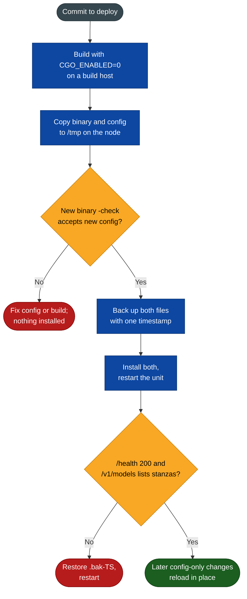

# Fleet swap-over and binary upgrades

> **Last reviewed:** 2026-11-22

Two procedures live here: the first swap on a node that still runs llama-swap,
and the binary and config upgrade on a node that already runs the router.

## Fleet state on 2026-11-22

| Node | Router | llama-swap | Config on disk |
|---|---|---|---|
| buster | 🟢 active, `:18080` | disabled, kept as rollback | real addresses inline, no overlay |
| gareths-homelab | 🟢 active, `:18080` behind nginx `:8081`/`:8082` | disabled, kept as rollback | real addresses inline, no overlay |
| nomad | 🟢 active, `:8081` | disabled, kept as rollback | real addresses inline, no overlay |
| digger | 🟢 active, `:8082` | disabled, kept as rollback | real addresses inline, no overlay |
| nugget | ⚪ offline (no ping reply, 2026-11-22) | unit present | not readable |

All four reachable nodes run the same build: sha256 `a1ae2a6610ce…`, commit
`0b1a93a` (v0.3.0). Check any node with `go version -m /opt/ai/bin/model-router`.
`/opt/ai/config/local/` does not exist on any of them, so the placeholder
overlay path (#195) is supported by the binary but not used in production yet.
See [Config and binary move together](#config-and-binary-move-together) before
you copy any tracked file onto a node.

## First swap (node still runs llama-swap)

Every step below is the procedure to run per node, in order. Each node's old
llama-swap stays installed as rollback (`systemctl stop llama-swap.service` is
only executed after the router passes its health checks on the same port).

Rollout order (least disruptive first):

1. **nomad** (single local model, 8 GB; use `/ui/` Chat lab to probe mesh peers)
2. **gareths-homelab** (nginx fronts the router; trivial rollback)
3. **digger** (small node; sdcpp-webui runs alongside, untouched)
4. **nugget** (V100; unit is `deploy/model-router.nugget.service`)
5. **buster** (LAST: rag-proxy, Open WebUI, Hermes depend on :18080)

---

## Per-node steps (run on the node, as root)

```bash
# 0. Pre-flight: confirm the ports the router will take over are the ones
#    llama-swap currently owns, and that no sidecar collides.
ss -tlnp | grep -E ':(18080|8081|8082)\b'   # per-node port from the table below

# 1. Install the binary + configs.
install -m 0755 build/model-router /opt/ai/bin/model-router

# NOTICE: configs/<node>.yaml carries placeholder addresses. Installing it on a
# node that has no overlay replaces every real peer URL with 10.99.0.x and the
# node stops reaching the mesh. Install the tracked file only when step 1b's
# overlay exists on that node. Otherwise keep the node's real-address
# /opt/ai/config/model-router.yaml and apply the stanza changes to it.
install -m 0644 configs/<node>.yaml /opt/ai/config/model-router.yaml
install -m 0644 configs/qwen-fixed-chat-template.jinja /opt/ai/config/qwen-fixed-chat-template.jinja

# 1b. The per-node overlay (#195): REAL peer URLs, discovery subnets and
#     trusted proxies live in /opt/ai/config/local/<node>.yaml, which is
#     untracked and merged at load time. NEVER copy a repo config over it, and
#     never write real addresses into configs/<node>.yaml.
#
#       /opt/ai/config/local/<node>.yaml     real values (already on the node)
#       configs/local/<node>.yaml            gitignored copy for reference
#
#     First install on a node that has none: split one out of its live config
#     before installing the placeholder file.
#
#       deploy/overlay-split.py --node <node> /opt/ai/config/model-router.yaml
#       install -m 0644 configs/local/<node>.yaml /opt/ai/config/local/<node>.yaml
#
#     Existing overlay: leave it alone. `-check` prints `overlay: <path>` when
#     one is merged, so step 2 shows whether the node got its real values.
# (peers are inline in the config for v0.1; the SPEC's separate peers.yaml can
#  be introduced later without schema changes)

# 2. Validate.
/opt/ai/bin/model-router -check -config /opt/ai/config/model-router.yaml

# 3. Install the unit (llama-swap.service is NOT touched).
install -m 0644 deploy/model-router.service /etc/systemd/system/
systemctl daemon-reload

# 4. Rollback safety: stop llama-swap BEFORE the router starts, so both never
#    fight over the same port/GPU. Do this and step 5 back-to-back.
systemctl stop llama-swap.service
systemctl start model-router.service

# 5. Verify (adjust port per node):
curl -s http://127.0.0.1:18080/health                 # OK
curl -s http://127.0.0.1:18080/v1/models | head -c 400 # unique mesh model_ids
curl -s http://127.0.0.1:18080/_router/status          # loaded models + telemetry

# 6. Smoke-test the real models (per-node list below), e.g.:
curl -s -X POST http://127.0.0.1:18080/v1/chat/completions \
  -H 'Content-Type: application/json' \
  -d '{"model":"agents-a1","messages":[{"role":"user","content":"ping"}]}'
# Expect a real completion; watch `journalctl -u model-router -f` for
# spawn + health messages.

# 7. Enable on boot after a successful soak (minutes to hours):
systemctl enable model-router.service
```

## Rollback (per node)

```bash
systemctl stop model-router.service
systemctl start llama-swap.service
# llama-swap reads its original config from /opt/ai/config/llama-swap.yaml
# (untouched). The router's config + binary remain installed for the next try.
```

## Config and binary move together

A config key is only understood by a build that has its parser. Installing a
config from a newer commit on an older binary fails at load and names the
stanza and the values it does accept:

```
[router:error] config: stanza "krea-2-turbo": image_pipeline caption "krea2" is not valid; use one of ideogram4
```

That is the real message from 2026-11-22: the morning build knew only
`ideogram4`, and `configs/buster.yaml` from master had grown the `krea2` caption
(#217). The same file passes `-check` on v0.3.0.

1. Never install a tracked config on a node whose binary predates the commit
   that added its newest key.
2. Run `-check` with the **new** binary against the **new** config, on the
   node, before either file is installed.
3. Ship the pair in one change. A binary-only swap is safe. A config-only swap
   is safe only when the config uses no key the installed binary lacks.
4. The binary has no `-version` flag, but the build embeds its commit. Read it
   with `go version -m /opt/ai/bin/model-router` and look for the `mod` line:

   ```
   mod	model-router	v0.0.0-20261122065042-0b1a93af22a9
   ```

   That is commit `0b1a93a` (v0.3.0). Quote it in the PR or ticket; mtime and
   sha256 are weaker evidence.

## Upgrade a running node (binary and config)

Use this on a node that already runs the router. v0.3.0 went out this way on
22 Nov 2026 to buster, gareths-homelab, nomad and digger.



```bash
# On a build host, from the commit to deploy (never in a node's working checkout):
CGO_ENABLED=0 go build -trimpath -ldflags="-s -w" -o build/model-router ./cmd/model-router
cp configs/<node>.yaml /tmp/mr.yaml
python3 deploy/stamp-image-caps.py /tmp/mr.yaml    # optional (#200); a second run changes nothing
scp build/model-router <node>:/tmp/model-router-new
scp /tmp/mr.yaml <node>:/tmp/mr.yaml               # placeholders only; see the NOTICE above

# On the node, as root. One timestamp keeps the pair together.
TS=$(date +%Y%m%d-%H%M%S)
cp -p /opt/ai/bin/model-router /opt/ai/bin/model-router.bak-$TS
cp -p /opt/ai/config/model-router.yaml /opt/ai/config/model-router.yaml.bak-$TS

# Gate: the NEW binary validates the NEW config. Nothing is installed if this fails.
/tmp/model-router-new -check -config /tmp/mr.yaml -node <node>

install -m 0644 /tmp/mr.yaml /opt/ai/config/model-router.yaml
install -m 0755 /tmp/model-router-new /opt/ai/bin/model-router
systemctl restart model-router.service   # restarts every backend it owns
curl -s http://127.0.0.1:<port>/health
curl -s http://127.0.0.1:<port>/v1/models | jq -r '.data[].id' | head
```

If `-check` or `/health` fails, put both `.bak-$TS` files back and restart.
A config-only change does not need a restart: `POST /_router/reload` (or
SIGHUP) reloads it in place.

## Check a tracked config against a live node

The tracked files carry placeholders, so a plain `diff` is noise. Normalise the
addresses first, then read what is left:

```bash
norm() { sed -E 's/[0-9]{1,3}(\.[0-9]{1,3}){3}/IP/g'; }
diff -u <(norm < configs/buster.yaml) <(norm < /opt/ai/config/model-router.yaml)
```

An empty diff is the goal. A non-empty one is either a repo-only key that a
later PR added (`catalog:`, `hf_repo:`, a `capabilities` form) or a live-only
change nobody mirrored. Decide which before deploying: production is
authoritative for what runs, the tracked file is what the next deploy installs.

## Per-node specifics

| Node | Router port | State | Verify against | Notes |
|------|-------------|-------|----------------|-------|
| buster | :18080 | 🟢 v0.3.0 | `qwen38-flash-next`, `qwen3-0.6b-instruct` (alias `intent-router`), `/v1/embeddings` | RTX 3090 + 2×V100. rag-proxy keeps pointing at 127.0.0.1:18080; NO rag-proxy change needed. Reranker/sparse/turbovec (:18095/:18096/:18097) untouched. |
| nomad | :8081 | 🟢 v0.3.0 | local `qwen3.5-9b`; Chat lab `qwen38-flash-next` then a mesh id | unlisted local stanza; catalog Load/Unload is local-only; remote ids route through the Chat lab |
| nugget | :8081 | ⚪ offline | `agents-a1` chat (preload), `qwen3-0.6b-instruct` | Swap as user kevyn; unit is `deploy/model-router.nugget.service` (memlock + TurboQuant lib path). Single V100. |
| gareths-homelab | 127.0.0.1:18080 (nginx :8081/:8082) | 🟢 v0.3.0 | `qwen2.5-1.5b-instruct` (preload), `krea-2-turbo` via /sdapi/v1/txt2img | RTX 5060 Ti 16GB. nginx blocks already proxy both ports → 18080; confirm `proxy_buffering off` for SSE |
| digger | :8082 | 🟢 v0.3.0 | `qwen3-0.6b-instruct`, `qwen3-vl-8b` | RTX 4060 8GB since 2026-11-22 (was a 24GB RTX PRO 4000). Config pruned to two stanzas; the image stanzas moved off this node. |

## Known v0.1 limitations (accept before swapping)

1. **Last-resort idle eviction, not in-flight preemption.** Stale occupants
   go first; if that is not enough, an idle resident (including ttl=0) is
   unloaded unless a request is mid-generation. In-flight work is never
   killed. If this node still cannot fit, the request spills to a peer that
   advertises the same `model_id`.
2. **VRAM numbers are measured then rounded up** (`docs/vram-fit-ladder.md`).
   After swap, compare `nvidia-smi` used to `vram_mb`. The router treats
   `vram_mb` as a hard reservation (fail-closed).
3. **Peer wiring goes directly to router ports** (buster :18080, not the old
   :8081 rag-proxy path). Update all peer base_urls at once so no node talks
   to a half-migrated fleet with a stale port.
4. **nvidia-smi per-GPU resilience:** a single GPU that drops off the PCIe bus
   (buster's X99 board has done this more than once) no longer blinds the whole
   poller; healthy GPUs still report. But a stanza pinned to the sick GPU
   cannot be admitted (fail-closed) until the driver recovers.
5. **Client disconnect during spin-up:** the request goroutine waits out the
   full spin-up window; the model still finishes loading and serves the next
   request. (SPEC open question: hold vs async polling.)

## Post-swap checklist

- [ ] `_router/status` shows loaded models + per-GPU free VRAM on every node
- [ ] peers see each other: `_router/status` → `peers` map has fresh timestamps
- [ ] cross-node request: from nomad `/ui/` Chat lab, `agents-a1` then `qwen3.8-27b` stream via a peer
- [ ] catalog Load/Unload on a **local** stanza actually start/stop the backend
- [ ] offline tolerance: `systemctl stop model-router` on one node; the others
      still 503 cleanly (no hang) for its models and keep serving local ones
- [ ] streaming chat (Open WebUI) shows tokens live through the router
- [ ] sd.cpp: Open WebUI image gen on digger/gareth works via /sdapi/v1
- [ ] `vram_mb` calibrated against nvidia-smi deltas
