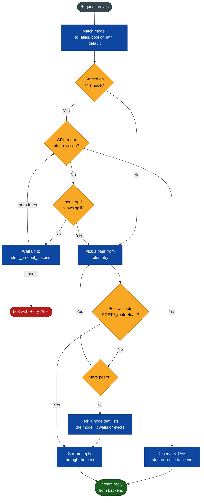

[Project README](../README.md) › Docs home

# model-router docs

> **Type:** Reference (index) · **Audience:** everyone · **Last reviewed:** 2026-11-22 · **Owner:** @kevyn

## Start here

| You are | Start with | Then |
|---|---|---|
| New to the repo | [README: What it does](../README.md#what-it-does) | [README: Build](../README.md#build) and [Run](../README.md#run) |
| Operator | [Swap-over procedure](../deploy/swap-over.md) | [README: Config](../README.md#config), [VRAM fit ladder](vram-fit-ladder.md) |
| Developer | [SPEC.md](../SPEC.md) | [Decisions](#all-pages), [Glossary](../GLOSSARY.md) |
| Agent | [AGENTS.md](../AGENTS.md) | [Agent setup pages](#all-pages) |

## How a request is served

Simplified: `on_failure` retries after an admit timeout and edge cases are left out. The detail behind each box is in [SPEC.md](../SPEC.md) and the three decision records below.

## All pages

Legend: 🟢 current · 🟡 needs review · 🔴 known wrong · 🔵 planned

| Section | Page | Type | Status | Last reviewed |
|---|---|---|---|---|
| Repo root | [README](../README.md) | Reference | 🟢 current | 2026-11-22 |
| Repo root | [SPEC](../SPEC.md) | Explanation | 🟢 current | 2026-11-22 |
| Repo root | [PLAN](../PLAN.md) | Explanation | 🟡 needs review (internal addresses, #184) | 2026-11-22 |
| Repo root | [Glossary](../GLOSSARY.md) | Reference | 🟢 current | n/a |
| Repo root | [CHANGELOG](../CHANGELOG.md) | Reference | 🟢 current | 2026-11-22 |
| Operations | [Deploy README](../deploy/README.md) | How-to | 🟢 current | 2026-11-22 |
| Operations | [Swap-over procedure](../deploy/swap-over.md) | How-to | 🟢 current | 2026-11-22 |
| Operations | [Backends](../deploy/backends.md) | Reference | 🟢 current | n/a |
| Operations | [Z-Image PE patch for sd-server](../third_party/stable-diffusion.cpp/README.md) | How-to | 🟢 current | 2026-11-22 |
| Reference | [VRAM fit ladder](vram-fit-ladder.md) | Reference | 🟢 current | 2026-11-22 |
| Decisions | [0001 Start cooldown is not a crash restart](adr/0001-start-cooldown-is-not-a-crash-restart.md) | Explanation | 🟢 current | 2026-11-22 |
| Decisions | [0002 Headroom is MB the node will not book](adr/0002-headroom-is-mb-the-node-will-not-book.md) | Explanation | 🟢 current | 2026-11-22 |
| Decisions | [0003 A failed load tries the next router peer](adr/0003-a-failed-load-tries-the-next-router-peer.md) | Explanation | 🟢 current | 2026-11-22 |
| Research | [Open-source model-router landscape](research/oss-model-router-landscape.md) | Explanation | 🟢 current (read 2026-10-25) | 2026-11-22 |
| Research | [Speech-to-text backends](research/stt-backends.md) | Explanation | 🟢 current (read 2026-11-20) | 2026-11-22 |
| Research | [Text-to-speech backends](research/tts-backends.md) | Explanation | 🟢 current (read 2026-11-20) | 2026-11-22 |
| Research | [Voice cloning backends](research/voice-cloning-backends.md) | Explanation | 🟢 current (read 2026-11-20) | 2026-11-22 |
| Research | [Realtime backends](research/realtime-backends.md) | Explanation | 🟢 current (read 2026-11-20) | 2026-11-22 |
| Research | [Video backends](research/video-backends.md) | Explanation | 🟢 current (read 2026-11-20) | 2026-11-22 |
| Research | [Music and sound-effect backends](research/music-sfx-backends.md) | Explanation | 🟢 current (read 2026-11-20) | 2026-11-22 |
| Research | [Z-Image prompt style](research/z-image-prompt-style.md) | Explanation | 🟢 current (read 2026-11-22) | 2026-11-22 |
| Research | [Z-Anime prompt style](research/z-anime-prompt-style.md) | Explanation | 🟢 current (read 2026-11-22) | 2026-11-22 |
| Research | [Krea 2 prompt style](research/krea2-prompt-style.md) | Explanation | 🟢 current (read 2026-11-22) | 2026-11-22 |
| Research | [FLUX.2 Klein prompt style](research/flux2-klein-prompt-style.md) | Explanation | 🟢 current (read 2026-11-22) | 2026-11-22 |
| Research | [Fibo 2.0 prompt style](research/fibo-2.0-prompt-style.md) | Explanation | 🟢 current (read 2026-11-22) | 2026-11-22 |
| Research | [FLUX.3 Klein prompt style](research/flux3-klein-prompt-style.md) | Explanation | 🟢 current (read 2026-11-22) | 2026-11-22 |
| Research | [Qwen-Image 2.1 prompt style](research/qwen-image-2.1-prompt-style.md) | Explanation | 🟢 current (read 2026-11-22) | 2026-11-22 |
| Agent setup | [Issue tracker](agents/issue-tracker.md) | Reference | 🟡 needs review (says GitHub; issues are also on Gitea) | 2026-11-22 |
| Agent setup | [Triage labels](agents/triage-labels.md) | Reference | 🟢 current | 2026-11-22 |
| Agent setup | [Domain docs](agents/domain.md) | Reference | 🟢 current | 2026-11-22 |

## See also

- [CHANGELOG](../CHANGELOG.md): what changed and when.
- [Glossary](../GLOSSARY.md): terms and abbreviations.
- [Z-Image prompt style](research/z-image-prompt-style.md): the research behind the `z-image` caption profile.
- [Z-Anime prompt style](research/z-anime-prompt-style.md): the research behind the `z-anime` caption profile.
- [Krea 2 prompt style](research/krea2-prompt-style.md): the research behind the `krea2` caption profile.
- [FLUX.2 Klein prompt style](research/flux2-klein-prompt-style.md): the research behind the `flux2-klein` caption profile.
- [Fibo 2.0 prompt style](research/fibo-2.0-prompt-style.md): the research behind the `fibo-2.0` caption profile.
- [FLUX.3 Klein prompt style](research/flux3-klein-prompt-style.md): the research behind the `flux3-klein` caption profile.
- [Qwen-Image 2.1 prompt style](research/qwen-image-2.1-prompt-style.md): the research behind the `qwen-image-2.1` caption profile.

## Linked from

<!-- backlinks:start -->
- [A failed load tries the next router peer](adr/0003-a-failed-load-tries-the-next-router-peer.md)
- [Domain Docs](agents/domain.md)
- [Fibo 2.0 prompt style](research/fibo-2.0-prompt-style.md)
- [FLUX.2 Klein prompt style](research/flux2-klein-prompt-style.md)
- [FLUX.3 Klein prompt style](research/flux3-klein-prompt-style.md)
- [Headroom is MB the node will not book](adr/0002-headroom-is-mb-the-node-will-not-book.md)
- [Issue tracker: Gitea](agents/issue-tracker.md)
- [Krea 2 prompt style](research/krea2-prompt-style.md)
- [Local music and sound-effect generation backends](research/music-sfx-backends.md)
- [Local realtime and speech-to-speech backends](research/realtime-backends.md)
- [Local speech-to-text backends](research/stt-backends.md)
- [Local text-to-speech backends](research/tts-backends.md)
- [Local video generation backends](research/video-backends.md)
- [model-router](../README.md)
- [Open-source model-router landscape](research/oss-model-router-landscape.md)
- [Qwen-Image 2.1 prompt style](research/qwen-image-2.1-prompt-style.md)
- [Start cooldown is not a crash restart](adr/0001-start-cooldown-is-not-a-crash-restart.md)
- [Triage Labels](agents/triage-labels.md)
- [Voice cloning and a voice library across router nodes](research/voice-cloning-backends.md)
- [VRAM fit ladder](vram-fit-ladder.md)
- [Z-Anime prompt style](research/z-anime-prompt-style.md)
- [Z-Image prompt style](research/z-image-prompt-style.md)
<!-- backlinks:end -->
