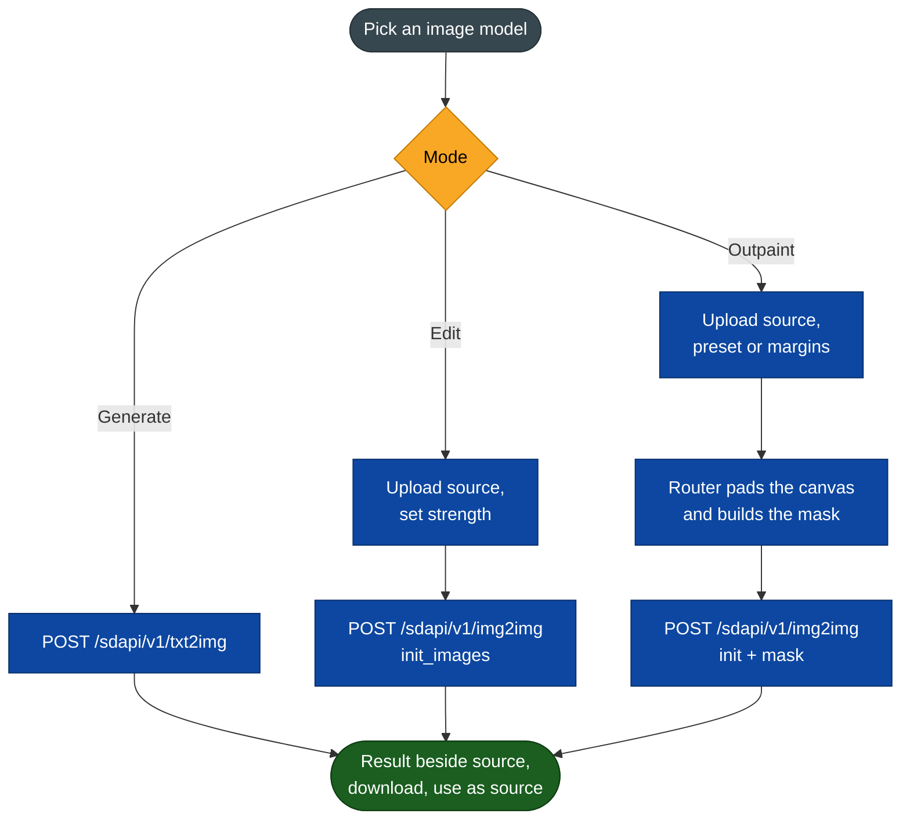

[Docs home](../../README.md) › [Playground](README.md) › Image editing

# Edit and outpaint an image in the Playground

> **Type:** How-to · **Audience:** operators · **Last reviewed:** 2026-11-22 · **Owner:** @kevyn

The Image tab has three modes. Generate is text to image. Edit sends a source image back through a model. Outpaint grows the canvas and asks the model to fill the new area.



## Before you start

The modes are gated on the model's capabilities, published on `/_router/status` and `/v1/models`:

| Flag | What it means | Where it is set |
|---|---|---|
| `img2img` | The model accepts `/sdapi/v1/img2img` with a source image | Tracked `configs/*.yaml`, stanza `capabilities` |
| `inpaint` | The model accepts a mask, so Outpaint is offered | Same |

A model without `img2img` has Edit disabled. Without `inpaint`, Outpaint is disabled. The tab falls back to Generate and shows the reason under the mode control. On **Path default** the gate follows the stanza marked `path_default: true`. If the mesh has no path-default image stanza, the tab uses the union of listed image flags.

`/_router/status` and `/v1/models` always include a `capabilities` array, even when it is empty. A selected model without `img2img` does not inherit the flag from another model.

`z-anime-turbo` stays generate-only in the tracked configs until a patched sd-server is deployed and approved. The live shared binary still omits reference tokens from Z-Image positional embeddings, so a router-path `POST /sdapi/v1/img2img` (the router copies `init_images[0]` into `extra_images`) aborts that process. txt2img is fine. A patch and build script live in [`third_party/stable-diffusion.cpp`](../../third_party/stable-diffusion.cpp/README.md); they were tested on a spare port and they stop the assert. Leave `capabilities` without `img2img` until that binary is the one the stanza runs. The #126 rollback (reverting a stanza to the shim command line) is unchanged.

## Generate

1. Pick a model, or leave **Path default**.
2. Type a prompt and an optional negative prompt.
3. Set width, height, steps, CFG and seed. Leave the seed at `-1` for random, or press **Randomise seed**.
4. Set a batch count if you want several images in one reply.
5. Select **Generate image**.

This posts to `/sdapi/v1/txt2img`. CFG and batch are new: they were fixed before.

## Edit

1. Set **Mode** to `Edit (image to image)`.
2. Choose a source with the picker, or drop a PNG, JPEG or WEBP on the drop zone.
3. The width and height default to the source size, not 512 by 512.
4. Set **Strength / denoise**. `0.2` keeps most of the source, `0.6` is a normal edit, `1.0` ignores the source pixels.
5. Type what you want changed.
6. Select **Apply edit**.

The result sits beside the source. **Use as new source** loads it back into the uploader so you can iterate, and **Download** saves the PNG.

## Outpaint

1. Set **Mode** to `Outpaint (expand and fill)`.
2. Choose the source image.
3. Pick a preset (`1.5x`, `2x`, `1:1`, `16:9`, `9:16`) or type per-side margins in pixels.
4. Check the preview. The source stays centred and the new area is shaded.
5. Type what should fill the new area. Leave **Fill strength** at `0.95`, because the border starts empty.
6. Select **Outpaint image**.

The preview is a convenience. **The router builds the bytes**: it decodes `init_images[0]`, pads the canvas with mid grey (`128,128,128`), builds a mask the same size (white where it must fill, black where it keeps the source), sets `width` and `height` to the padded size, attaches `mask` and removes the `outpaint` field before the backend sees the request. A curl client gets the same result as the page.

## Outpaint from the command line

```bash
curl -s http://127.0.0.1:18080/sdapi/v1/img2img \
  -H 'Content-Type: application/json' \
  -d "$(jq -n --arg img "$(base64 -w0 source.png)" '{
        model: "sd3.5-inpaint",
        prompt: "a wide empty beach at dusk",
        init_images: [$img],
        denoising_strength: 0.95,
        steps: 20,
        outpaint: {preset: "16:9"}
      }')" | jq -r '.images[0]' | base64 -d > outpainted.png
```

Explicit margins work the same way: `"outpaint": {"top": 128, "bottom": 128, "left": 0, "right": 0}`.

| Field | Meaning |
|---|---|
| `outpaint.preset` | `1.5x`, `2x`, or a ratio such as `16:9`. Mutually exclusive with the margins |
| `outpaint.top` / `bottom` / `left` / `right` | Pixels to add per side, each at most 4096 |
| result size | At most 8192 px on a side, refused above that |
| `denoising_strength` | The client sets it. Outpaint does not override it |

## Troubleshooting

| Symptom | Cause | Fix |
|---|---|---|
| Edit or Outpaint is greyed out | The stanza has no `img2img` / `inpaint` flag | Add the flag to `configs/<node>.yaml` and to the live config, only if the backend actually serves that mode |
| `z-anime-turbo` Edit is greyed out, or a curl img2img returns `502 upstream error` | The live sd-server still aborts on Z-Image edit (PE length, #203) | Leave Edit off until the patched binary in `third_party/stable-diffusion.cpp` is deployed and approved. txt2img still works |
| `400 img2img requires non-empty init_images` | No source, or the upload did not decode | Re-pick the file. Only PNG, JPEG and WEBP are accepted |
| `400 outpaint preset "x"` | Unknown preset | Use `1.5x`, `2x` or `a:b` |
| The border comes back as grey | The model ignored the mask | Try an `inpaint`-capable stanza. Not every img2img model reads masks |
| Result size is not what you typed | Outpaint sets the size from the padded canvas | Set the margins, not the width and height |

## See also

- [Router config reference](../../SPEC.md): capability flags and the request pipeline.
- [Z-Image reference-token PE patch for sd-server](../../third_party/stable-diffusion.cpp/README.md): the patch, build script and deploy steps.
- [Video playground](../../README.md): the other async job playground.

## Linked from

<!-- backlinks:start -->
- [Model Router: SPEC](../../SPEC.md)
- [model-router](../../README.md)
- [model-router docs](../README.md)
- [Playground guides](README.md)
<!-- backlinks:end -->
