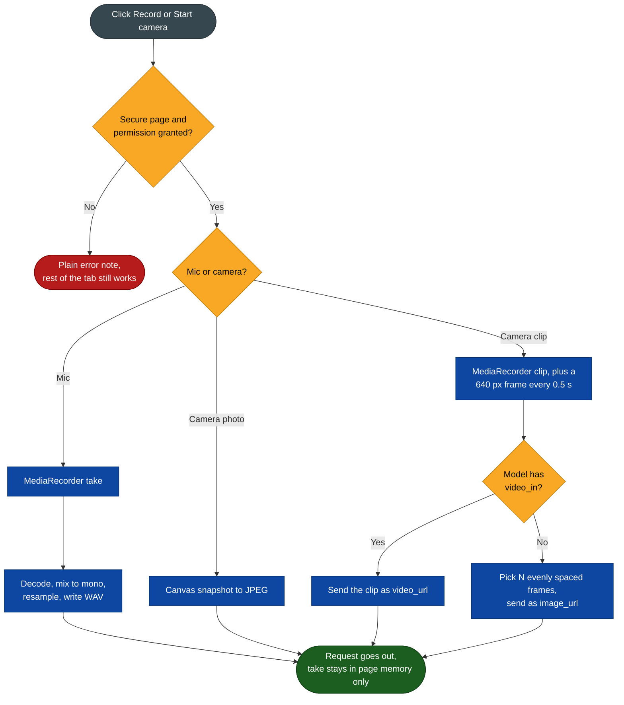

[Project README](../../README.md) › Use the mic and camera in the Playground

# Use the mic and camera in the Playground

> **Type:** How-to · **Audience:** operators and developers testing models · **Last reviewed:** 2026-11-22 · **Owner:** @kevyn

Record from your mic or camera straight into a Playground request. You don't have to save a file first and upload it. The browser converts each take into the format the route accepts, and only shows the controls the selected model can use.

## Before you start

- **HTTPS or localhost.** Browsers only allow the mic and camera on a secure page. If you open `/ui/` as `http://<router-host>:<port>`, the controls show but stay greyed out, with a note. Use an HTTPS reverse proxy in front of the router, or an SSH tunnel so the page loads from `localhost`.
- **Permission.** The browser asks the first time you start the mic or camera. Allow it for the router's address.
- **Capability flags.** Chat capture follows the model's `capabilities` in its stanza. See [What each model gets](#what-each-model-gets).

> [!NOTE]
> Nothing you record is stored by the Playground. Takes live in the page as blobs, go out in the request that uses them, and are dropped when you discard them or reload. The one exception is **Save to voice library**, which writes the clip to the router's `voice_dir` on purpose.

## What each model gets

| Tab | Input | Sent as | Shown when |
|---|---|---|---|
| Chat | 📷 Photo | `image_url` part, JPEG data URI, longest side 1280 px | model has `vision` |
| Chat | 🖼️ Image file | `image_url` part, data URI | model has `vision` |
| Chat | 🎥 Clip, native | one `video_url` part, MP4 or WebM data URI | model has `video_in` |
| Chat | 🎥 Clip, frames | 1 to 16 evenly spaced `image_url` frames (default 6), 640 px | model has `vision` but not `video_in` |
| Chat | 🎙️ Mic | `input_audio` part, WAV 16 kHz mono 16-bit | model has `audio_in` |
| Transcription | 🎙️ Mic | multipart `file`, WAV 16 kHz mono 16-bit | any transcription model |
| Speech | 🎙️ Mic or file, use once | `ref_audio` data URI + `ref_text`, or `speaker_ref_b64` + `lang` | any speech model; shape follows its `clone_mode` |
| Speech | 🎙️ Mic or file, save | `POST /v1/audio/voices` multipart, WAV 24 kHz mono | any speech model |
| Video | 📷 Photo or 🎥 clip | multipart `input_reference` | any video model |

Limits per take: chat audio 30 s, transcription 120 s, voice clone 30 s, camera clip 10 s.

> [!TIP]
> llama-server with an `--mmproj` takes images but not `video_url`, so give it `vision` only and the Playground sends frames. Add `video_in` only for a backend that decodes video itself, such as a vLLM Qwen-VL server.

> [!WARNING]
> `video_in` is new. A node running an older router binary rejects a config that uses it, so update the binary on each node before you add the flag to its stanzas.

## How a take becomes a request

## Steps

### Transcribe from the mic

1. Open **Playground** › **Transcription** and pick the model.
2. Under **Or record from the microphone**, pick the mic if you have more than one.
3. Click **Record**, talk, then click **Stop**. To push to talk, hold the button down while you talk and let go to stop.
4. Play the take back if you want to check it. Click **Discard** to throw it away.
5. Click **Transcribe audio**.

**Done when:** the transcript shows in **Result**. Choosing a file after recording replaces the take, and recording again replaces the file.

### Send a photo, clip or voice note to a chat model

1. Open **Playground** › **Chat** and pick a model flagged `vision`, `video_in` or `audio_in`.
2. Under **Camera**, click **Start camera**.
3. Click **Take photo**, or **Record clip** then **Stop clip**. Each one lands in the attachment list.
4. For a `vision` model, set **Frames sent from a clip**.
5. Under **Microphone**, record a voice note the same way as above.
6. Type the message and click **Send streaming request**.

**Done when:** the reply streams in. Attachments stay until you remove them, so you can try another prompt on the same capture. Switching to a model that can't take an attachment removes it.

### Clone a voice

1. Open **Playground** › **Speech**, pick the model and expand **Clone a voice from the mic or a file**.
2. Record 5 to 30 seconds of clear speech, or choose an audio file.
3. Type exactly what the clip says in **What the clip says**, and set **Language** (for example `en`).
4. To try it once without storing anything, tick **Use this clip on the next Generate**, then click **Generate audio**.
5. To keep it, enter a **Library name** (lower case, digits and dashes), tick the consent box, and click **Save to voice library**.

**Done when:** the generated audio plays in the cloned voice, or the saved name shows in the **Voice** list.

> [!CAUTION]
> Only clone a voice when the speaker has agreed to it. The library refuses a clip without the consent tick, and keeps who and when in the voice's sidecar file.

### Use the camera as a video reference

1. Open **Playground** › **Video** and pick the model.
2. Under **Or use the camera as the reference**, click **Start camera**.
3. Click **Take photo** or **Record clip**. The take shows under the preview.
4. Click **Generate video**.

**Done when:** the job starts. The camera take is sent as `input_reference`, the same field the file picker fills.

## Problems

| You see | Do this |
|---|---|
| "The browser only allows the mic and camera on HTTPS or localhost." | Open the UI over HTTPS, or tunnel the router port to `localhost` with SSH. |
| "Permission to use the microphone was refused." | Allow the mic or camera in the browser's site settings for the router's address, then reload. |
| "No camera was found." | Plug one in, or pick another device in the picker. |
| "The camera is busy or blocked." | Close video calls or other apps using it. |
| "Nothing was recorded." | Check the level bar moves when you talk, and pick another mic. |
| `HTTP 413` on send | The take is over the router's `max_request_body_mb`, or over `voice_max_seconds` for a library clip. Record a shorter take or send fewer frames. |
| The model ignores the image | Check the stanza has `vision` and the backend was started with its `--mmproj`. |

## See also

- [README: Config](../../README.md#config): the `capabilities` flags, including `video_in`.
- [SPEC.md](../../SPEC.md): `clone_mode` and the voice library routes.
- [Voice cloning backends](../research/voice-cloning-backends.md): which backends take `ref_audio` and which take `speaker_ref_b64`.
- [Speech-to-text backends](../research/stt-backends.md): what whisper.cpp accepts.

## Linked from

<!-- backlinks:start -->
- [model-router](../../README.md)
- [model-router docs](../README.md)
- [Playground guides](README.md)
<!-- backlinks:end -->
