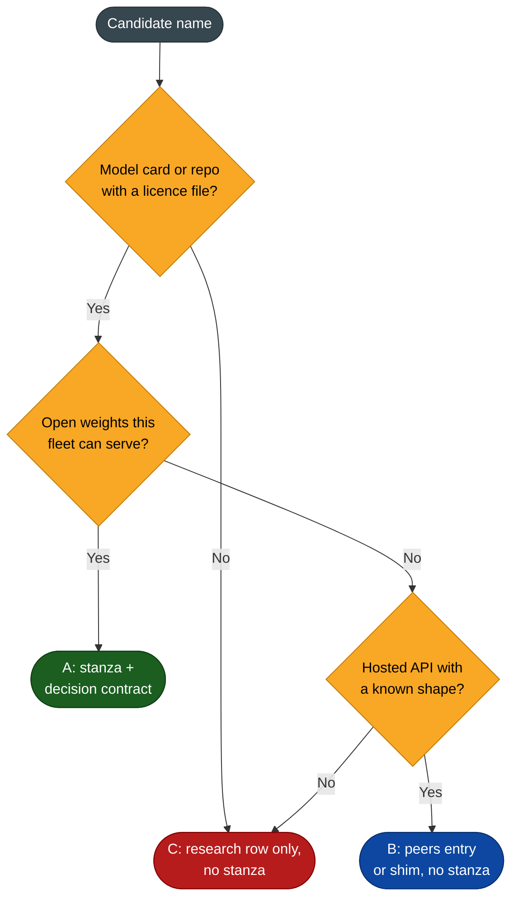

[Docs home](../README.md) › Research › Decision models

# Decision models

> **Type:** Explanation · **Audience:** maintainers · **Last reviewed:** 2026-11-26 · **Owner:** @kevyn

Phase 0 for #225: what each named decision model is, whether it resolves to
real weights or a real API, and whether this fleet can serve it. Sources were
read on 2026-11-25 from search results and the pages they quote. Nothing here
was run on a GPU. Anything not confirmed from the source itself is marked
**(verify)**.

A decision model does not generate text. It runs one forward pass over a
**state** (text, JSON, sometimes an image or audio) and a set of **named,
typed questions**, and returns a probability for each option the application
supplied. The common wire shape is the System One API, `POST /v1/systemone`.

## The gate

Each candidate resolves to one class before the router does anything with it.

## Verdicts

Legend: 🟢 acted on in #225 · 🟡 resolves, not acted on yet · 🔴 unresolved

| Candidate | Class | Params | Serving format | Context | Licence | Verdict |
|---|---|---|---|---|---|---|
| Kev-9B | A | 9B base (frozen) + 45.4M LoRA + pointer head | GGUF on llama-server (`POST /v1/systemone`); also the repo's own Python server | 65,536-token states (card, per #225) | Apache-2.0 (adapter, head and base) | 🟢 the `kev-9b` fixture and example stanza |
| NeoHorse-Jev-4B | A | about 4B | Own runtime (`neohorse-decision serve`, FastAPI), vLLM or SGLang; its GGUF repo ships its own llama.cpp-based runtime | not stated (verify) | Apache-2.0 badge; licence file not opened (verify) | 🟡 same System One shape; needs its own launch command and a GPU check |
| Laya | A | 421M (English), 322M (multilingual) | Python package `laya`; llama-server lists Laya in PR #29818 (verify the GGUF) | 512 / 1,024 tokens per checkpoint; 0.5 claims 73,728 (verify) | Apache-2.0 | 🟡 small enough for any node; card says confidences ship uncalibrated |
| OpenJev | C | unknown | A repo, not weights; the name also covers three other repos and a 27B GGUF in PR #29818 | unknown | **Conflict:** #225 says CC BY-NC 4.0; the repo's README badge says MIT (verify the licence file itself) | 🔴 no stanza until one repo, its weights and its licence file line up |
| d1-Omni-2B | A | 2.17B | GGUF on llama-server b11960 or newer, `POST /v1/systemone` | not stated (verify) | LFM Open License v1.0; commercial terms not read (verify) | 🟡 text, picture and audio states; llama.cpp support is partial |
| Span-02 | B | 26B-A4B mixture of experts (verify) | Hosted: Respan gateway `/api/v1/systemone` and `/api/v1/decisions`; weights reportedly on the hub (verify) | 131,072 tokens | hosted service; weights licence listed as Apache-2.0 by one directory (verify) | 🟡 paid per token; the gateway path needs a shim, so no peer entry yet |

### Sources

| Candidate | Model card or repo | Licence and contract source |
|---|---|---|
| Kev-9B | [jaredpalmer/kev-9b](https://huggingface.co/jaredpalmer/kev-9b), revision `b5d8c18e` (v2, Kev 1.0, 2026-09-30) | [Kev README](https://github.com/jaredpalmer/kev/blob/main/README.md), [ggml-org/Kev-9B-GGUF](https://huggingface.co/ggml-org/Kev-9B-GGUF), [llama.cpp PR #29818](https://github.com/ggml-org/llama.cpp/pull/29818) |
| NeoHorse-Jev-4B | [TokenRhythm/NeoHorse-Jev-4B](https://huggingface.co/TokenRhythm/NeoHorse-Jev-4B) | [DEPLOYMENT.md](https://huggingface.co/TokenRhythm/NeoHorse-Jev-4B/blob/main/DEPLOYMENT.md), [NeoHorse-Jev-4B-GGUF](https://huggingface.co/TokenRhythm/NeoHorse-Jev-4B-GGUF) |
| Laya | [convaiinnovations/laya](https://huggingface.co/convaiinnovations/laya) | [Independent calibration study, arXiv 2609.33843](https://arxiv.org/pdf/2609.33843) |
| OpenJev | `OpenJev` repository as linked in #225 | its README licence section (MIT) and the licence file in the repo root, not opened (verify) |
| d1-Omni-2B | [LiquidAI/d1-Omni-2B-GGUF](https://huggingface.co/LiquidAI/d1-Omni-2B-GGUF) | [llama.cpp PR #31275](https://github.com/ggml-org/llama.cpp/pull/31275), [vendor docs](https://docs.liquid.ai/lfm/models/d1-omni-2b) |
| Span-02 | [Span-02 announcement](https://www.respan.ai/blog/introducing-span-2) | [Run span-02](https://www.respan.ai/docs/apis/gateway/run-span-02), [quickstart](https://www.respan.ai/docs/documentation/span-02/quickstart) |
| System One API | [System One reference](https://docs.typesafe.ai/api/system-one) | [Choice](https://docs.typesafe.ai/primitives/choice), [Score](https://docs.typesafe.ai/primitives/score) |

## What a decision looks like

Every System One backend answers the same envelope: `model`, `answers` keyed
by the question names sent, and `usage` (`input_tokens`, `output_tokens`,
the second always 0). Each answer carries its `type`.

| Question type | Answer fields | Notes |
|---|---|---|
| `choice` | `choice`, `confidence`, `probabilities` (one per option) | 1 to 255 options. `confidence` comes from the spread of `probabilities`, so it is not the winning option's probability. |
| `score` | `score` (probability-weighted), `legend`, `probabilities` keyed by level, `confidence` | Rubric of 2 to 10 ordered levels. |
| `noul` | `noul` (probability the statement is true) | No separate confidence. |

Per model:

- **Kev-9B, d1-Omni-2B, Laya and OpenJev on llama-server:** the System One
  shape above. llama-server picks decision mode from the GGUF metadata, no
  flag needed (PR #29818). Kev's own server adds `/v1/systemone/permute` and
  `/v1/systemone/separate`.
- **NeoHorse-Jev-4B:** its HTTP runtime takes `POST /v1/systemone` with
  `questions` keyed by name and returns "a structured decision distribution"
  (verify the exact field names against the System One shape).
- **Laya (Python):** typed answers with probabilities from `agent.predict(...)`;
  per #225 the 0.5 release adds abstain, a conformal `prediction_set` and
  `unbound` (verify).
- **Span-02:** one answer per question with probabilities and a confidence,
  plus a fourth `number` type and an optional reasoning budget (`mode`,
  `budget_ms`). Streaming is refused with a 400.

## Calibration

| Model | Metric and value | Dataset | Who measured |
|---|---|---|---|
| Kev-9B | ECE 0.045 (v2); temperature T = 2.19 takes it from 0.103 to 0.041; confident errors 8.2 % to 2.4 % | Kev's held-out sources | developer |
| Kev-9B | Brier 0.286 (dev) / 0.237 (test), Jev 0.211 (dev) | out-of-domain sets in the Kev README | developer |
| Kev-9B | ECE 0.377 with the stored temperature | CLINC-150, [arXiv 2610.00346](https://arxiv.org/html/2610.00346v1) | independent |
| Kev-9B | smooth ECE about 0.08 to 0.125 per question | TypedBench, [arXiv 2610.11392](https://arxiv.org/pdf/2610.11392) | independent |
| Laya | none published; the card says to treat its confidences as uncalibrated | n/a | developer |
| d1-Omni-2B | none found; the vendor says to calibrate thresholds on your own data | n/a | developer |
| NeoHorse-Jev-4B, OpenJev, Span-02 | none found (verify) | n/a | n/a |

Kev's calibration is one temperature. It cannot reorder confidences, so the
independent CLINC-150 result is the one to plan around: gate on Kev's
`confidence` only after checking it on your own labels.

## Latency claims and what they measure

| Claim | Model | What it measures | Hardware | Batch / percentile |
|---|---|---|---|---|
| 44 ms | NeoHorse-Jev-4B | "about 44 ms" in an OpenZeka whitepaper | not stated (verify) | not stated (verify) |
| about 50 ms | NeoHorse-Jev-4B | top-level `decision_seconds` on a hosted API, from a client library | hosted, unknown | single request |
| 32.8 ms | Laya multilingual (322M) | single-pass classification | Tesla T4 | not stated, read as batch 1 (verify) |
| 39.5 ms, "about 33 ms" | Laya English (421M) | single-pass classification; 33 ms is the headline | Tesla T4 | not stated (verify) |
| 590 ms median, 798 ms p95 | Kev-9B | per decision, read from a cost-against-latency figure (verify the column meaning) | hosted notebook GPU, model unknown | median and p95 |
| 111.6 ms p50, 112.4 ms p95 (328.2 ms cold first pass); 35.4 ms p50 single `choice` | Kev-9B (`Kev-9B-BF16.gguf`) | `POST /v1/systemone` (3 questions: `choice`, `score`, `noul`; and 1 `choice`) | buster RTX 3090 24 GB (`16,532 MiB` VRAM, `llama.cpp-olala` `55c22dc`) | batch 1, warm (N=25) |
| 33 ms median, 822 ms p95 | Span-02 | Jev Decision Index run, reasoning on when unsure | one RTX PRO 6000, vendor engine | median and p95 |

None of these numbers is comparable with another: different models, cards,
batching and question counts. The fleet number that counts is the p50 from
the smoke test in [Backends](../../deploy/backends.md#8-decision-models).

## Benchmarks

**"0.852 vs 0.857"** is not a like-for-like pair. Both come from Kev's own
README, on datasets Kev was not trained on:

| Split | Kev-9B | Jev |
|---|---|---|
| Development set | 0.820 | 0.857 |
| Locked test set | 0.852 | not run |
| Held-out examples from Kev's training sources | 0.874 | 0.845 |

The metric name is not given in what was read (verify; probably accuracy).
The Kev README itself flags the comparison as uncontrolled. Independent
runs put Kev-9B between 0.850 and 0.863 on CLINC-150, level with other small
decision models.

## Servable on this fleet

| Candidate | llama-server | vLLM / SGLang | Hosted | Fits |
|---|---|---|---|---|
| Kev-9B | 🟢 verified on `llama.cpp-olala` (`55c22dc`, includes PR #29818); `/opt/ai/bin/llama-server` (`llama.cpp-unified` `10881`) lacks `/v1/systemone` | not needed | no | BF16 (`16,532 MiB` VRAM) on the 24 GB RTX 3090 node; Q4_K_M (about 7 GB) on any 12 GB card |
| NeoHorse-Jev-4B | 🟡 only its own llama.cpp-based runtime | 🟢 yes | a client library targets one | 4B, any 16 GB card (verify) |
| Laya | 🟡 listed in PR #29818 (verify) | n/a | no | well under 2 GB |
| d1-Omni-2B | 🟢 b11960 or newer, partial | n/a | no | 2B, any card |
| OpenJev | 🔴 unresolved | 🔴 | 🔴 | unknown |
| Span-02 | n/a | n/a | 🟢 Respan, paid | n/a |

The Kev-9B smoke test on buster's RTX 3090 confirmed that `llama.cpp-olala`
(`0.5.0-dev`, commit `55c22dc`, which includes PR #29818) serves
`Kev-9B-BF16.gguf` on `POST /v1/systemone` for `choice`, `score` and `noul`.
However, `/opt/ai/bin/llama-server` (`llama.cpp-unified`, `10881`) on buster
does not include `/v1/systemone`, so decision stanzas need the `llama.cpp-olala`
binary until `/opt/ai/bin/llama-server` is rebuilt on a post-PR-#29818 base.
The passthrough design
([ADR 0004](../adr/0004-decision-models-pass-system-one-through.md)) rests on
the published System One contract, not on llama-server.

## What #225 ships and what it leaves

| Item | State |
|---|---|
| `api_type: decision`, `decision_style: systemone` | 🟢 shipped |
| `kev-9b` example stanza (`configs/kev-9b.example.yaml`) | 🟢 shipped, loaded by no node |
| Real-weights smoke test and p50 on the 24 GB node | 🟢 passed on buster RTX 3090 via `llama.cpp-olala` (`16,532 MiB` VRAM; `111.6 ms` p50 3-question, `35.4 ms` p50 1-question) |
| GGUF file name and the Kev revision it was converted from | 🟢 `Kev-9B-BF16.gguf`, `.src_sha` `db029f08` (weights unchanged from `b5d8c18e`) |
| NeoHorse, Laya, d1 stanzas | ⚪ later ticket, one per model |
| OpenJev | 🔴 blocked on the licence conflict |
| Span-02 peer | ⚪ needs a path shim and a billing decision |

## See also

- [ADR 0004: decision models pass System One through](../adr/0004-decision-models-pass-system-one-through.md): the design this research chose.
- [Backends](../../deploy/backends.md#8-decision-models): the Kev-9B smoke test.
- [SPEC.md: Decision models](../../SPEC.md#decision-models): the router contract.

## Linked from

<!-- backlinks:start -->
- [Backend runtime layout](../../deploy/backends.md)
- [Decision models pass System One through](../adr/0004-decision-models-pass-system-one-through.md)
- [Model Router: SPEC](../../SPEC.md)
- [model-router](../../README.md)
- [model-router docs](../README.md)
<!-- backlinks:end -->
