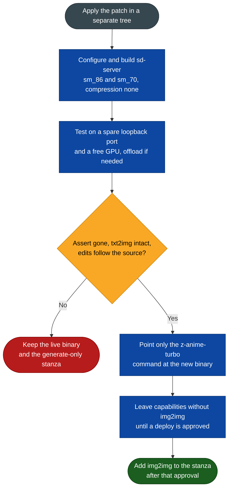

[Docs home](../../docs/README.md) › stable-diffusion.cpp Z-Image PE patch

# Z-Image reference-token PE patch for sd-server

> **Type:** How-to · **Audience:** operators · **Last reviewed:** 2026-11-22 · **Owner:** @kevyn

This is a minimal patch to [leejet/stable-diffusion.cpp](https://github.com/leejet/stable-diffusion.cpp) so Z-Image img2img and edit no longer abort. It is not deployed yet. Tracked stanzas keep `z-anime-turbo` generate-only until that deploy is approved.

Base commit: `532d2c15c430a785a712b2d94281f04e733008a4` (`master-1106-532d2c1`, 2026-11-15). The file is [`z-image-ref-pe.patch`](z-image-ref-pe.patch). Build with [`deploy/build-sd-server-zimage-ref-patch.sh`](../../deploy/build-sd-server-zimage-ref-patch.sh).

## What it fixes

On an edit, the router copies `init_images[0]` into `extra_images` when that field is empty. sd-server treats `extra_images` as reference latents (`pass_to_dit` defaults to true) and concatenates those tokens onto the image stream. `Rope::gen_z_image_ids` still had a comment "ignore ref_latents for now", so the positional embeddings covered only text plus the target image. `ZImageModel::forward_core` then hit:

```
GGML_ASSERT(txt->ne[1] + img->ne[1] == pe->ne[3])
```

Plain txt2img, and img2img with no `extra_images`, never took that path and already worked.

## What the patch does

It only changes `Rope::gen_z_image_ids` in `src/model/common/rope.hpp`.

- After the target image IDs are built, each reference latent gets IDs from the same helper Flux and Qwen use (`gen_flux_img_ids` with `ref->ne[1]`, `ref->ne[0]`, and the model patch size). Those tensors are still unpatchified latents, matching `gen_z_image_pe`.
- Spatial RoPE stays aligned with the target (origin 0, 0). The temporal axis is one step after the target (`index + 1`). That matches the Z-Image paper (section 4.1) and leaves txt2img IDs unchanged. The target already sits at `padded_context_len + 1`, so refs must not reuse `padded_context_len` (the last caption pad) or the target index.
- `RefIndexMode::INCREASE` steps the temporal index up per ref. `DECREASE` starts at `index + n` and steps down, and never lands on the target index. The default `FIXED` mode keeps every ref at `index + 1`.
- Combined target-plus-ref length is padded to `SEQ_MULTI_OF` (32) after the refs are appended, which matches `forward_core`.

Do not reuse Qwen-Image or Flux Kontext spatial packing (`gen_refs_ids`) for Z-Image. Those pack refs beside the target in space. Z-Image wants the same spatial grid and a temporal offset only.



## Build notes

> **NOTICE:** Do not write into the live `stable-diffusion.cpp/build` directory and do not overwrite the live `sd-server` binary. Other image stanzas share that binary. Build in a separate folder and point only `z-anime-turbo` at the new path, once approved.

- `GGML_CUDA_COMPRESSION_MODE=none` is required on the current host (driver 535, CUDA 12.2 max, nvcc 12.9). The default `size` compression produces kernels the driver will not load ("device kernel image is invalid").
- Target `70;86` so the same binary can run on the sm_86 card and the sm_70 cards.
- Use the official nvcc at `/usr/local/cuda-12.9/bin/nvcc` when that toolkit is the one CMake finds.
- Keep the compile job count modest (about 12 to 14) so running engines stay responsive.
- At runtime set `GGML_CUDA_PDL=0`, same as the live stanza. Prefer `--flash-attn off,diffusion=on` over the deprecated `--diffusion-fa`.
- If the chosen GPU already holds other engines, use `--offload-to-cpu` and, if needed, `--max-vram` or `--backend vae=cpu`. Do not evict those engines.

## Test results (2026-11-22, AEST)

Tested against the same z-anime-turbo weights the stanza uses, on the sm_86 card, with `--offload-to-cpu --max-vram 16`, on a spare loopback port. The live router, live binary, live config and other engines were not touched. The test server was stopped afterwards; GPU memory returned to the baseline.

| Request | Seconds | HTTP | Notes |
|---|---|---|---|
| Health `GET /v1/models` | 0.03 | 200 | Already listening after load-into-RAM |
| txt2img, 8 steps, 512, seed 43 | 23.27 | 200 | First request includes weight load. Sampling itself was 11.17 s. Coherent red S15 at a night meet |
| img2img, 4 steps, denoise 0.6, init only | 3.36 | 200 | Follows the cartoon source. No crash |
| img2img, 8 steps, denoise 0.6, init only, blue prompt | 5.26 | 200 | Follows the source. Colour stayed red |
| img2img, 8 steps from the txt2img result, blue prompt | 3.61 | 200 | Same scene, slightly wetter ground, still red |
| img2img, 4 steps, denoise 0.6, with `extra_images` (#203 path) | 4.05 | 200 | Log showed `EDIT mode` and `target t_enc is 2 steps`. No assert. Layout follows the source, but softer and blurrier than init-only |
| img2img, 8 steps, `extra_images`, blue prompt | 4.34 | 200 | Same: structure holds, still red, soft |
| img2img, 8 steps, `extra_images`, from the txt2img result | 4.37 | 200 | Same composition as the source photo, flatter and a bit mushier |

Plain img2img (init only) already worked on the unpatched server and looks closer to the source. The crash only happens on the router path, which also sends `extra_images`. That path no longer asserts. Edit quality on this distill is softer than generate, and a denoise of 0.6 did not produce the requested colour change. z-anime-turbo may not have been trained as an official Z-Image edit model. Look at the result PNGs before turning Edit on.

A side-by-side against the live binary on the same sm_86 card was not possible: that binary was built for sm_70 only.

## Deploy (needs approval)

1. Merge the model-router PR that carries this patch. That change does not swap the live binary and does not add `img2img` to the stanza.
2. Confirm the live config does not advertise `img2img` for `z-anime-turbo` until you want Edit offered. Tracked `configs/*.yaml` in that PR already drop the flag. If the live file still lists it, remove it when you apply the config so the Playground cannot send an edit to the unpatched binary.
3. Leave the live shared binary in place. Either use the already-built patched binary in a separate folder, or run `deploy/build-sd-server-zimage-ref-patch.sh` to rebuild one.
4. Change only the `z-anime-turbo` stanza `command` so it points at the patched `sd-server`. Keep `--offload-to-cpu` and `GGML_CUDA_PDL=0`. Prefer `--flash-attn off,diffusion=on`.
5. Apply that config only with approval. A hot reload is enough if the command line is all that changed; the next spawn of z-anime-turbo will use the new binary. Do not restart the live router unless you have approval to do that.
6. Check txt2img still looks right, then one router-path img2img (the Playground Edit path, which sends `extra_images`). If the quality is acceptable, add `capabilities: [img2img]` in a follow-up change.

## Upstream pull request (draft only)

This description is ready for [leejet/stable-diffusion.cpp](https://github.com/leejet/stable-diffusion.cpp). It has not been opened.

**Title:** Fix Z-Image positional IDs when reference latents are present

**Body:**

```
Z-Image img2img / edit aborts in ZImageModel::forward_core with:

    GGML_ASSERT(txt->ne[1] + img->ne[1] == pe->ne[3])

When extra_images (or other ref images) are present, image.cpp encodes
them as ref_latents with pass_to_dit defaulting to true. forward()
patchifies those latents and concatenates them onto the image token
stream. Rope::gen_z_image_ids still ignored ref_latents, so the PE
tensor was only long enough for text plus the target image.

This change is limited to gen_z_image_ids:

- Build target image IDs first, at the existing temporal index
  (padded_context_len + 1), so txt2img positions do not change.
- Append each ref with gen_flux_img_ids using the unpatchified
  latent height and width (ref->ne[1], ref->ne[0]) and the model
  patch size, the same convention as gen_refs_ids.
- Give refs the same spatial origin as the target and a temporal
  index of target + 1 (a unit offset), as described in the Z-Image
  paper section 4.1. FIXED keeps that index for every ref; INCREASE
  steps up; DECREASE starts at target + n and steps down, never
  onto the target index.
- Pad the combined target-plus-ref length to SEQ_MULTI_OF, which
  matches the padding forward_core applies after the concat.

I did not reuse Qwen-Image / Flux Kontext spatial packing. That
layout places refs next to the target in space. Z-Image wants
aligned spatial RoPE and a temporal offset only.

Tested on Z-Image (an 8-step distill) at 512x512: txt2img still
produces a coherent image; img2img with extra_images no longer
hits the assert and keeps the source layout. Edit sharpness on
this particular distill is softer than generate, which may be a
model limitation rather than a PE-length bug.
```

## See also

- [Edit and outpaint an image in the Playground](../../docs/playground/image-editing.md): capability gating and why Edit stays off for z-anime-turbo.
- [Issue 203](https://git.kevynwatkins.com/kevyn/model-router/issues/203): the crash report and test notes.

## Linked from

<!-- backlinks:start -->
- [Edit and outpaint an image in the Playground](../../docs/playground/image-editing.md)
- [model-router docs](../../docs/README.md)
- [Playground guides](../../docs/playground/README.md)
<!-- backlinks:end -->
